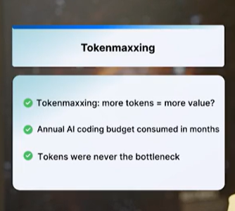
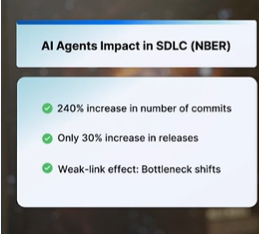
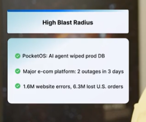
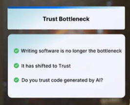
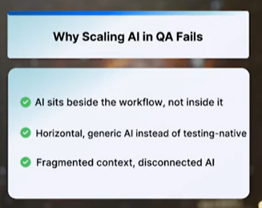

# Beyond the AI Code Boom: Why Trust is the New Currency of Software Engineering

AI helps write software faster than ever, but **how do we ensure it is safe?**  
This session tackles the "Trust Bottleneck", the new gap between AI code generation and production confidence.  
Join **Sudhir Manjunath** to explore how to transform quality assurance from a final roadblock into a continuous system of trust, measure real AI ROI, and future-proof QA teams.

> Output is set by the weakest link

## The Quality Shift

* From end-stage gate to continuous part of SDLC
  * How much bugs reached customer.
* From tests to truth: defining what correct means
* From counts to confidence & trust

> AI has now made Software development abundance  
> Trust is now the Scarce resource

> Unintentionally QA has become unintentional bottleneck

* Metrics for CTO's
  * How many story points was delivered
  * Developer code commit to production

* **What would you do first with AI if you are leading a small team?**
  * Plug and play solutions with AI
  * So that my team can foucs on core things like revisiting the PRDs

* **what are other bottlenecks?**
  * Everyone has thier own definition of token maxing
  * Test cases were not exhaustive
  * Maintenence of the test cases and scripts

* Are there any other bottlenecks apart from context that you see that the QA team is facing in translating this adoption into real business outcomes?
  * context covers 80-90% bottleneck

* Understanding the business context is equally important
  * finance domain or healthcare domain - they should have a very strong hold on their

* Now AI taking over all these entry level work. If the practice that built our judgement disappears how does the next generation of senior QA engineers and leaders get built?
  * Prompt Engineering - how accurately they give

* I would interview them based on their past experience, what kind of projects they have worked upon.

* What should they start from Monday Morning?
  * Don't just focus on - how do I identifying locators or how do I write scripts
  * Have deep domain knowledge
  * Treat AI outcome with a lot of skepticism

