# ADAPT to AI: The 90-Day Blueprint for Quality Engineering Careers

AI is undeniably changing QA workflows, but your career trajectory isn't predetermined. This session tackles the uncomfortable realities of AI task automation and explores how the QA profession is evolving from execution into quality intelligence and AI assurance. Join us for a practical look at the difference between testing with AI and testing AI itself, and walk away with a 90-day plan to adapt your skills and prove your impact.

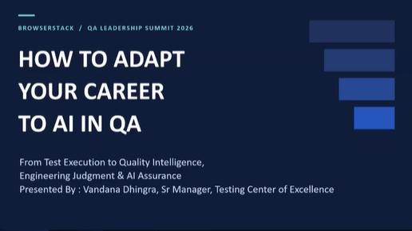

> How requirements are analyzed
> how tests are designed  
> how defects are investigated  
> If technologyy can perform more of the work i do today, how do I continue creating value tomorrow  
> Today we will explore that question realistically, including where AI creates uncertainty

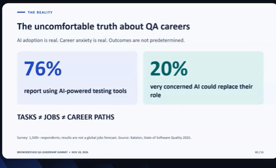

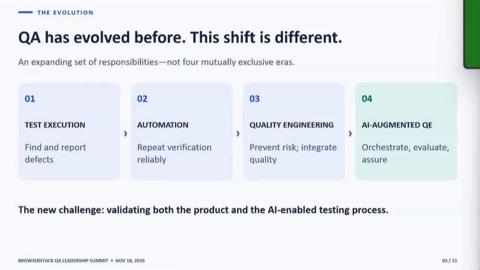  

> We are not testing just application, we are also testing the AI that is helping created that application and helpling us test that application  

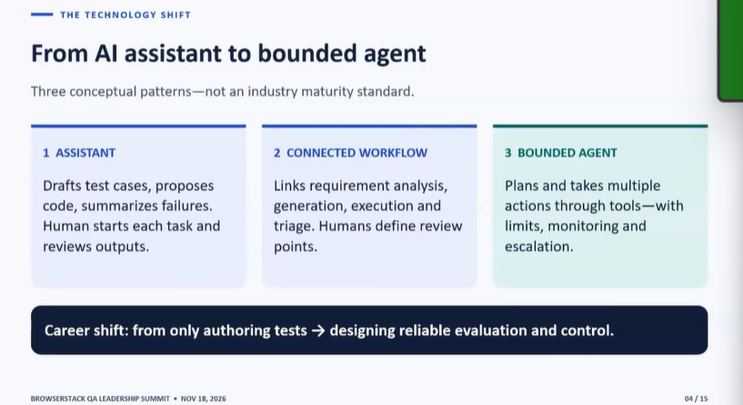

> You don't have to become and agent developer overnight but understand agentic workflows will increasingly help you collaborate acrosss engineering teams  
> I believe we need to redefine ourselves around the outcomes we are responsible for, not the task we do  
> That means moving beyond test execution into system thinking, quality architecture, risk analysis, evaluating AI generated results  

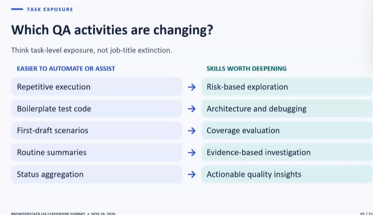

> Amount of automation never menas that our quality of testing is good. AI creates similar risk, only at a much greater speed because AI works way faster and AI exposes the flawas in the processes much faster  
> So that's where the human judgement or the real QE mindset or the tester mindset kicks in  
> we still need to understand the requirement, business rules, boundary conditions, system dependiencies, what failure means to the users.
> Tools doesn't elemintate the need of thinking  

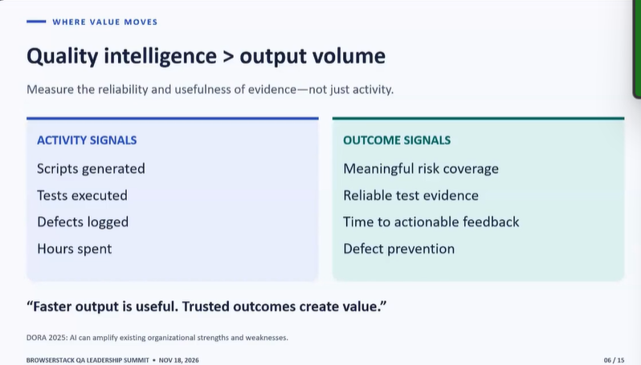

> Faster is not always good. Trusted outcome creates value  

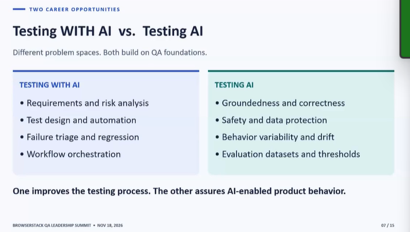

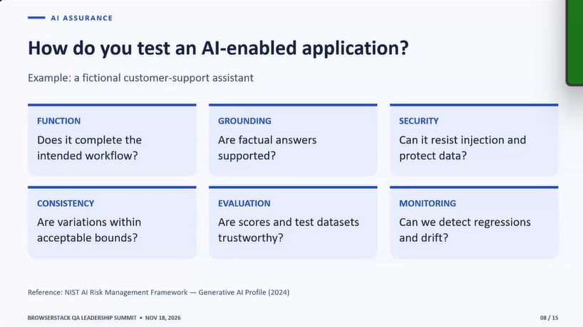

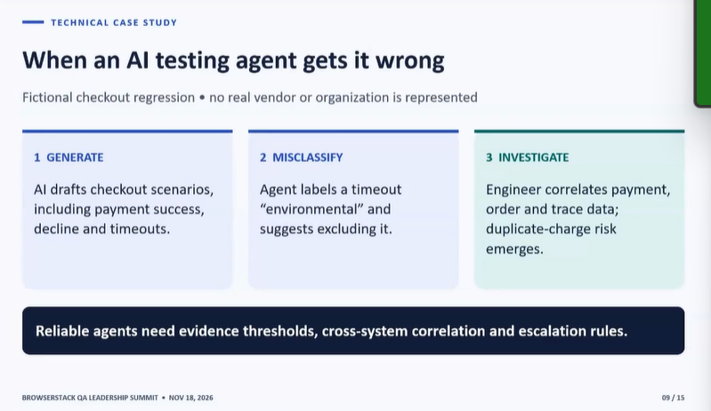

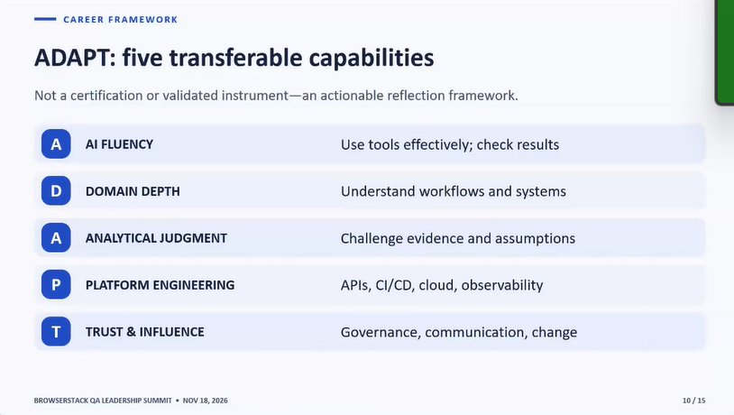

> Rather than chasing every AI product launch, I suggest developing on these capabilites  

> Communicate every quality concern and collaborate acors engineering functions  

> We used to talk about everybody

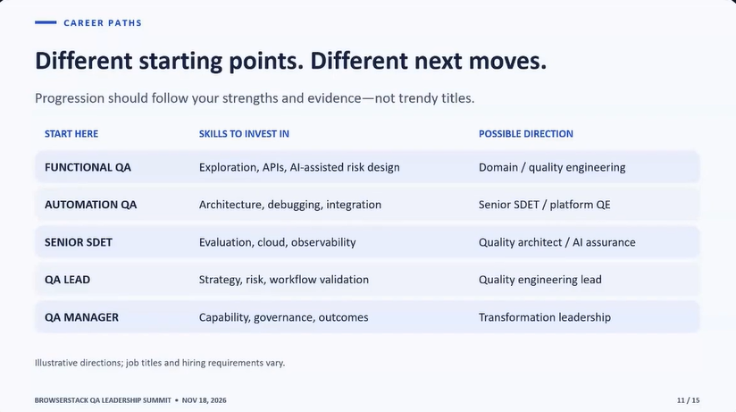

> Historically many QA professionals have faced a career ceiling  

> Please go and evaluate what pathways you have currently for your QA team members  

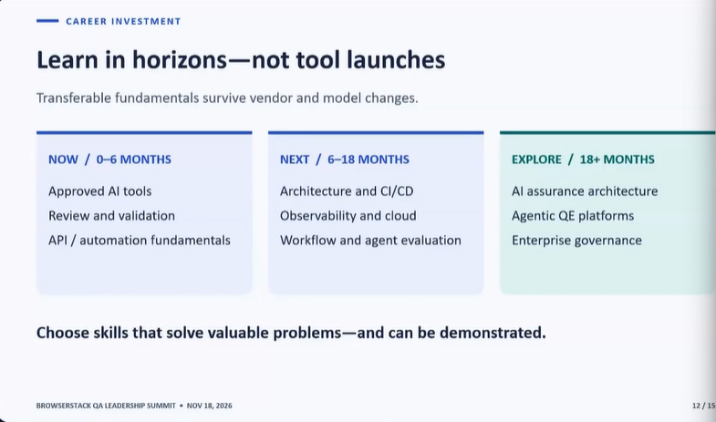

> Don't pursue every certification or every new framework simply because it is trending  
> Ask yourself first, will this help me solve and important problem?  
> Can I demostrate it and will the underlying knowledge tranfer when the tool changes  
> That is how we can make some informed career descision wha are intentional  c
> choose a skill which solve valuable problem

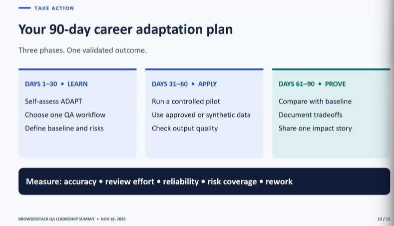

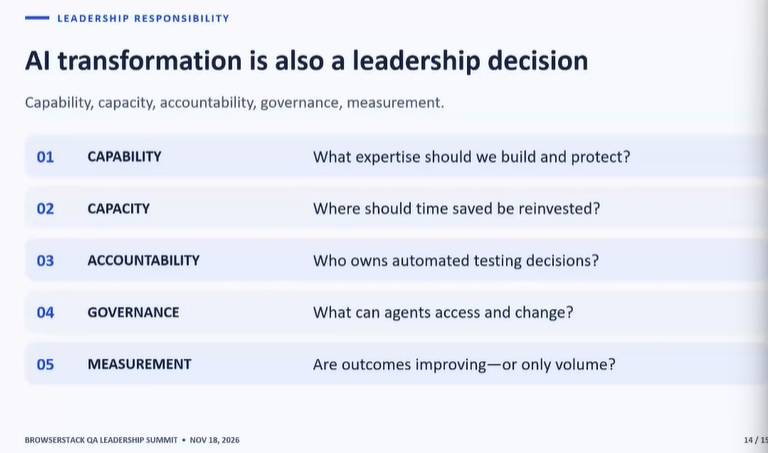

> Crate a psychological safety  
> People should be able to ask a basic question  
> Share unsuccessful experiments or admit they don't understnad the technolgoy without feeling theyare failing or falling behind  

> Are we providing meaningful learning opportunites or simply expecting people to become AI ready on their own  

> Last year 70% of the code was generated but how much was productiion quality  

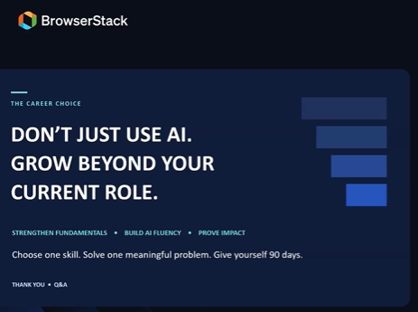